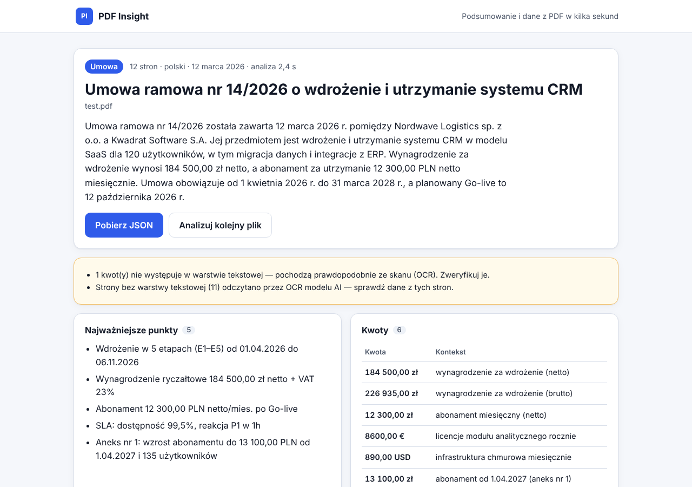

# PDF Insight

Aplikacja webowa, która wczytuje plik PDF, tworzy jego krótkie podsumowanie i zamienia treść
w uporządkowane dane JSON (zadanie rekrutacyjne — Vibe Coder, Greywolf Group).

**Demo:** https://xsajdq.github.io/Vibe-project/



## Jak to działa

1. **Wgranie PDF** — drag & drop lub wybór z dysku (klawiatura: Tab → Enter). Tylko PDF, maks. 10 MB,
   weryfikowana jest też sygnatura `%PDF-` (samo rozszerzenie nie wystarczy).
2. **Odczyt tekstu** — w przeglądarce, przez `pdf.js` (strona po stronie). Strony bez warstwy
   tekstowej (skany) są renderowane do JPEG i trafiają do modelu jako obrazy (OCR).
3. **Analiza AI** — backend (Cloudflare Worker) wysyła tekst do LLM (Google Gemini) ze schematem
   odpowiedzi, waliduje wynik (Zod), w razie błędu robi **1 ponowną próbę**, potem zwraca komunikat.
4. **Wynik** — podsumowanie, kluczowe punkty, kwoty, daty, podmioty, słowa kluczowe, podgląd JSON
   i pobranie pliku `.json`. Frontend ponownie waliduje wynik schematem przed wyświetleniem.

### Zakres funkcjonalny

| ID   | Priorytet | Status | Realizacja                                                                           |
| ---- | --------- | ------ | ------------------------------------------------------------------------------------ |
| F-01 | MUST      | ✅     | `Dropzone.tsx`, `validateFile.ts` — D&D, wybór pliku, typ, rozmiar, sygnatura        |
| F-02 | MUST      | ✅     | `lib/pdf.ts` — `pdf.js`, łączenie fragmentów tekstu wg pozycji (polskie znaki)       |
| F-03 | MUST      | ✅     | prompt + walidacja 3–5 zdań (`shared/sentences.ts`), język dokumentu                 |
| F-04 | MUST      | ✅     | `shared/schema.ts` (Zod) — walidacja na backendzie i frontendzie                     |
| F-05 | MUST      | ✅     | `ResultView.tsx`, `JsonPreview.tsx`, `exportJson.ts`                                 |
| F-06 | MUST      | ✅     | stan pusty, ładowanie (kroki + licznik czasu, anulowanie), błąd z „Spróbuj ponownie” |
| F-07 | MUST      | ✅     | GitHub Pages przez GitHub Actions                                                    |
| F-08 | SHOULD    | ✅     | `worker/src/chunk.ts` — fragmenty ~60 tys. znaków analizowane równolegle + scalenie  |
| F-09 | SHOULD    | ✅     | `lib/history.ts` — 10 ostatnich wyników w `localStorage` (bez treści PDF)            |
| F-10 | COULD     | ✅     | strony-skany → obraz → OCR w modelu multimodalnym (maks. 3 strony)                   |

## Architektura

```
┌────────────────────────┐   POST /api/analyze    ┌──────────────────────────┐   HTTPS   ┌──────────────┐
│ React SPA (Vite, TS)   │ ─────────────────────► │ Cloudflare Worker        │ ────────► │ Gemini API   │
│ GitHub Pages           │  tekst stron + skany   │ CORS · rate limit · Zod  │  klucz w  │ (OpenAI-     │
│ pdf.js → tekst/obrazy  │ ◄───────────────────── │ prompt · retry · scalanie│  secrecie │  compatible) │
└────────────────────────┘   JSON (schemat 04)    └──────────────────────────┘           └──────────────┘
```

```
shared/            wspólny kod frontend ↔ backend
  schema.ts        schemat wyniku (Zod) — jedno źródło prawdy + typy TS
  api.ts           kontrakt HTTP i limity
  sentences.ts     licznik zdań (walidacja podsumowania 3–5 zdań)
src/               frontend (React)
  components/      widoki: Dropzone, ProgressView, ErrorView, ResultView, JsonPreview, HistoryList
  lib/             pdf.js, walidacja pliku, historia, eksport, formatowanie, hook useAnalysis
  api/             klient HTTP backendu (timeout, mapowanie błędów, walidacja odpowiedzi)
worker/            backend (Cloudflare Worker)
  src/index.ts     routing, CORS, limity, obsługa błędów
  src/analyze.ts   orkiestracja: fragmenty → model → walidacja/retry → scalenie → grounding
  src/prompt.ts    instrukcja systemowa, schemat odpowiedzi, budowa wiadomości
  src/llm.ts       klient Chat Completions (dowolny dostawca zgodny z OpenAI)
  src/grounding.ts weryfikacja kwot w tekście źródłowym, deduplikacja
```

### Najważniejsze decyzje

- **Cloudflare Workers jako backend** — darmowy plan, brak „zimnego startu”, sekrety poza repo,
  wbudowany Rate Limiting binding, deploy z GitHub Actions.
- **Ekstrakcja tekstu w przeglądarce, nie na serwerze** — do API trafia tylko tekst (dziesiątki KB
  zamiast 10 MB pliku), co jest szybsze i mieści się w limitach CPU Workera.
- **Gemini przez endpoint zgodny z OpenAI** — darmowy limit, model multimodalny (OCR skanów bez
  dodatkowych bibliotek), structured output. Zmiana dostawcy (np. Groq, OpenRouter) to tylko
  zmienne `AI_BASE_URL`, `AI_MODEL`, `AI_API_KEY` — bez zmian w kodzie.
- **Jeden schemat Zod w `shared/`** używany przez Workera, frontend i testy — brak rozjazdu typów.
  Model dostaje dodatkowo JSON Schema (`response_format`), ale źródłem prawdy jest walidacja Zod.
- **`fileName` i `pages` nie pochodzą od modelu** — ustawiane deterministycznie przez kod.
- **Anty-halucynacje:** kwoty zwrócone przez model są sprawdzane w tekście źródłowym (dowolny zapis:
  `184 500,00 zł`, `12,5 tys.`) i usuwane, jeśli ich tam nie ma. Gdy dokument zawiera skany (tekst
  ze skanu zna tylko model), kwoty nie są usuwane, tylko oznaczane ostrzeżeniem.
- **Długie dokumenty (map → reduce):** fragmenty analizowane równolegle; listy (kwoty, daty,
  podmioty) łączone deterministycznie w kodzie, a podsumowanie i punkty kluczowe — przez jedno
  dodatkowe wywołanie modelu na podstawie wyników częściowych.
- **Brak routera** — aplikacja ma jeden widok, więc nie ma problemu z odświeżaniem podstron na GitHub
  Pages (HashRouter / 404.html niepotrzebne). `base` w `vite.config.ts` = `/<repo>/`, worker
  `pdf.js` importowany przez `?url`, więc Vite nadaje mu poprawną ścieżkę.

## Bezpieczeństwo

- **Klucz API wyłącznie w sekretach** (Cloudflare Worker secret, ustawiany z GitHub Secrets przez
  Actions). Frontend zna tylko adres Workera (`VITE_API_URL`). `.env` i `.dev.vars` są w `.gitignore`.
- **CORS ograniczony do domeny demo** (`ALLOWED_ORIGINS`); żądania z innych originów i bez nagłówka
  `Origin` są odrzucane (403).
- **Limity:** 8 analiz / minutę na IP (Cloudflare Rate Limiting), plik ≤ 10 MB, ciało żądania ≤ 4 MB,
  ≤ 400 tys. znaków tekstu, ≤ 3 strony-skany, timeouty po stronie klienta i serwera.
- **Prompt injection — treść PDF to dane, nie instrukcje:** instrukcja systemowa wprost zakazuje
  wykonywania poleceń z dokumentu; tekst jest zamknięty w bloku `<document>…</document>`, a próby
  „wyjścia” z bloku (znacznik zamykający w PDF) są neutralizowane; odpowiedź ograniczona schematem
  i walidowana; kwoty weryfikowane w tekście.
- **Bez `dangerouslySetInnerHTML`** (dodatkowo blokowane regułą ESLint) — wszystko renderowane jako
  tekst. `pdf.js` działa z `isEvalSupported: false`.
- **Informacja dla użytkownika**, że tekst pliku trafia do zewnętrznego API AI (i że w darmowym
  planie dostawca może używać danych do ulepszania usług). Worker nie loguje treści dokumentów.

## Uruchomienie lokalne

Wymagania: Node.js 22+, darmowy klucz Gemini API (https://aistudio.google.com/apikey).

```bash
npm install

# 1) Backend — sekrety lokalne w worker/.dev.vars (plik ignorowany przez Git)
cp worker/.dev.vars.example worker/.dev.vars   # uzupełnij AI_API_KEY
npm run dev:worker          # http://localhost:8787

# 2) Frontend (w drugim terminalu)
cp .env.example .env.local  # VITE_API_URL=http://localhost:8787
npm run dev                 # http://localhost:5173/Vibe-project/
```

Skrypty: `npm run lint`, `npm run format:check`, `npm run typecheck`, `npm test` (Vitest),
`npm run build`.

### Zmienne środowiskowe

| Zmienna               | Gdzie                    | Opis                                                                 |
| --------------------- | ------------------------ | -------------------------------------------------------------------- |
| `VITE_API_URL`        | frontend (build)         | adres Workera, np. `https://pdf-insight-api.<konto>.workers.dev`     |
| `VITE_BASE`           | frontend (build)         | opcjonalnie; domyślnie `/Vibe-project/`, w CI ustawiane z nazwy repo |
| `AI_API_KEY`          | Worker — **secret**      | klucz API dostawcy LLM                                               |
| `AI_BASE_URL`         | Worker (`wrangler.toml`) | endpoint zgodny z OpenAI; domyślnie Gemini `…/v1beta/openai`         |
| `AI_MODEL`            | Worker (`wrangler.toml`) | domyślnie `gemini-3.8-flash`                                         |
| `AI_REASONING_EFFORT` | Worker (`wrangler.toml`) | `low` — krótszy czas odpowiedzi                                      |
| `ALLOWED_ORIGINS`     | Worker                   | dozwolone originy (CSV); w CI: `https://<właściciel>.github.io`      |

## Wdrożenie (GitHub Actions)

Dwa workflowy; publikacja odbywa się tylko z domyślnej gałęzi repozytorium:

- **`deploy.yml`** — `lint › build › deploy`: Prettier, ESLint, `tsc` (strict), Vitest, build Vite
  i publikacja na GitHub Pages.
- **`worker.yml`** — testy i `wrangler deploy` Workera wraz z ustawieniem sekretu `AI_API_KEY`.

Jednorazowa konfiguracja repozytorium:

1. **Settings → Pages → Source: GitHub Actions.**
2. **Settings → Secrets and variables → Actions → Secrets:**
   `CLOUDFLARE_API_TOKEN` (szablon „Edit Cloudflare Workers”), `CLOUDFLARE_ACCOUNT_ID`, `AI_API_KEY`.
3. Uruchom workflow „Deploy API” i skopiuj adres Workera (`https://pdf-insight-api.<subdomena>.workers.dev`).
4. **Settings → Secrets and variables → Actions → Variables:** `VITE_API_URL` = adres Workera,
   następnie uruchom ponownie „CI / Deploy frontend”.

## Testy

`npm test` — 60+ testów jednostkowych (Vitest):

- **walidacja schematu** (`shared/schema.test.ts`): daty ISO 8601 (także nieistniejące, np. 30.02),
  waluty ISO 4217, język ISO 639-1, 3–5 zdań, 3–7 punktów, `null`/`[]`, pola dodatkowe;
- licznik zdań odporny na skróty („sp. z o.o.”, „S.A.”, „12.03.2026 r.”);
- API Workera: CORS, limity, 1 ponowna próba po błędnej odpowiedzi AI, mapowanie błędów dostawcy,
  dzielenie długich dokumentów, neutralizacja znacznika `</document>` z PDF;
- grounding kwot, chunking, historia w `localStorage`, ekstrakcja tekstu (sklejanie fragmentów).

## Znane ograniczenia

- **Darmowy plan Gemini** ma niskie limity zapytań — przy wielu użytkownikach naraz może pojawić się
  komunikat o chwilowym limicie (aplikacja pokazuje go z opcją ponowienia). W darmowym planie Google
  może wykorzystywać przesłane treści — w UI jest o tym informacja.
- **OCR** obejmuje maks. 3 strony-skany na dokument (limit rozmiaru żądania i czasu); jakość zależy
  od modelu. Kwot ze skanów nie da się zweryfikować w tekście — są oznaczane ostrzeżeniem.
- **Dokumenty bardzo długie** (> 400 tys. znaków) są przycinane z ostrzeżeniem; scalanie wyników
  fragmentów wydłuża analizę (dodatkowe wywołanie modelu).
- Licznik zdań jest heurystyczny — przy nietypowych skrótach podsumowanie może zostać uznane za
  niepoprawne i wygenerowane ponownie (1 ponowna próba).
- Weryfikacja kwot jest celowo prosta (dopasowanie liczby w tekście) — nie wykrywa kwoty istniejącej
  w tekście, ale przypisanej do złego kontekstu.
- Rate limit działa per IP — nie chroni przed rozproszonym nadużyciem; przy realnym ruchu warto
  dodać np. Cloudflare Turnstile.
- Pliki PDF zabezpieczone hasłem nie są obsługiwane (czytelny komunikat).

## Praca z AI

Opis narzędzi, kluczowych promptów i błędów AI: [AI_LOG.md](AI_LOG.md).
